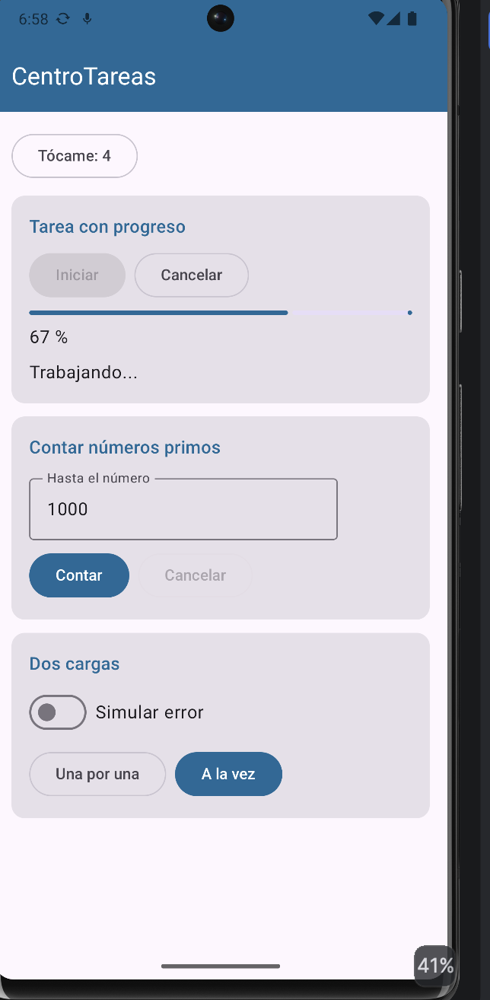
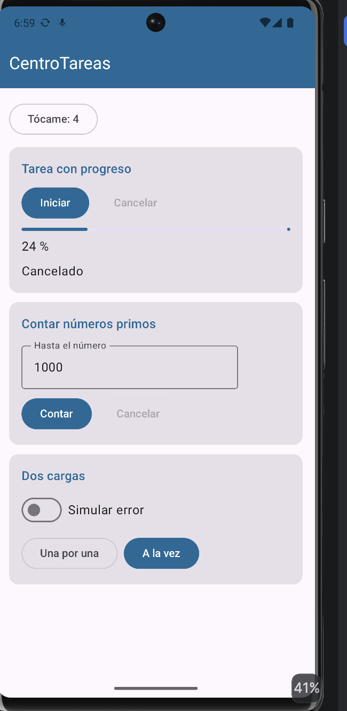
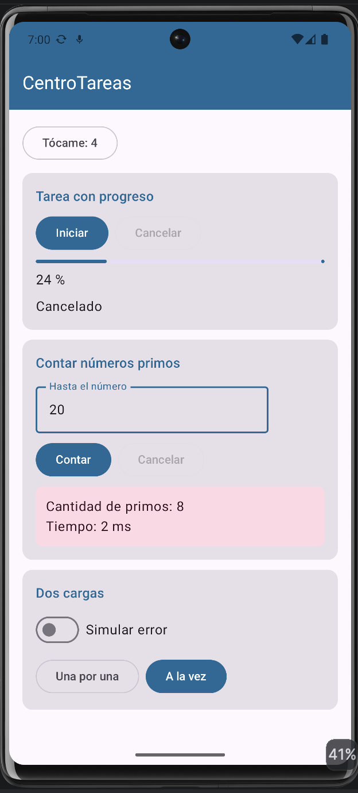
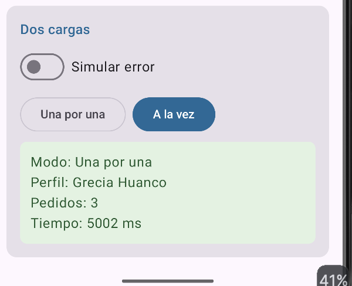
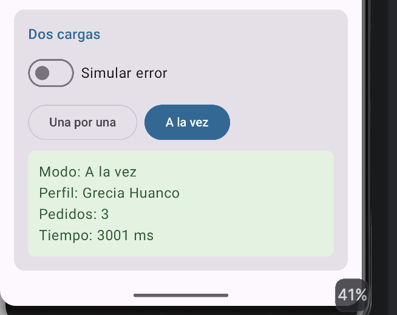
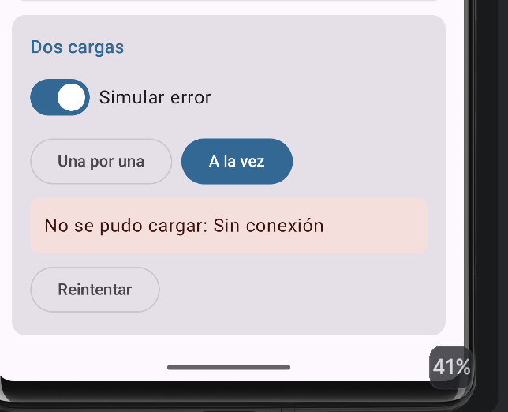

# CentroTareas

Aplicación Android para practicar corrutinas, progreso, cancelación y cargas de datos.

## Estructura

```text
com.huanco.centrotareas/
├── data/       Repositorio
├── model/      Estados de la interfaz
├── ui/         Pantalla
└── viewmodel/  Lógica
```

## MVVM

```text
Pantalla → ViewModel → Repositorio
```

## Observación del paso 1

Con `Thread.sleep`, la pantalla se congelaba por cuatro segundos. No se veía «Trabajando...» y el contador no respondía porque el hilo principal estaba ocupado.

## Observación de los pasos 2 al 5

Las corrutinas mantienen la pantalla receptiva mientras se ejecutan las tareas. El progreso se actualiza y se puede cancelar; el conteo de primos corre en segundo plano y devuelve 168 para el límite de 1000.

## Capturas

1. **Tarea con progreso** 



2. **Tarea cancelada** 



3. **Cálculo de primos** 



4. **Cargas**: captura de «Una por una»  y otra de «A la vez» 





5. **Error y reintento** 



## Para pensar

1. **¿Por qué no se veía «Trabajando...»?** El hilo principal estaba ocupado y no podía actualizar la pantalla.
2. **¿Qué diferencia hay entre `Thread.sleep` y `delay`?** `Thread.sleep` bloquea el hilo; `delay` suspende la corrutina.
3. **¿Para qué sirven `Dispatchers.Default` e `IO`?** `Default` es para cálculos; `IO`, para entrada y salida. Las cargas de esta app son simuladas.
4. **¿Qué pasa al cerrar la pantalla?** `viewModelScope` cancela las corrutinas del ViewModel cuando este se destruye.
5. **¿Por qué `async` tarda unos 3 segundos?** Las cargas ocurren en paralelo y se espera a la más lenta. Si una falla, se muestra un error y se puede reintentar.
